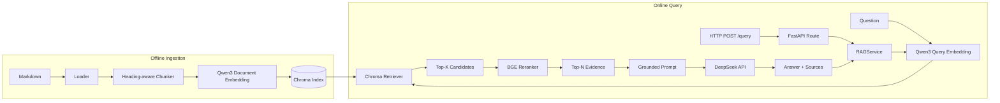

# Personal RAG

一个从零实现并逐步工程化的个人知识库 RAG 系统。知识库主要由个人项目总结、开发记录和技术交接 Markdown 文档组成；系统在不重新训练 LLM 的情况下，通过 retrieval + generation 使用这些私人知识回答问题。

项目没有直接建立在 LangChain 或 LlamaIndex 之上，而是自行实现 Loader、Chunker、Embedding、Vector Store、Retriever、Reranker、Prompt Builder 与 Service 等主要模块，以便理解并验证完整 RAG pipeline 的职责边界。

## 核心能力

- Markdown 加载与 paragraph-aware、heading-aware Chunking
- `Qwen/Qwen3-Embedding-0.6B` 本地文本向量化
- Chroma 持久化向量索引
- Two-stage Retrieve + Rerank
- Grounded Prompt、context citation 与信息不足处理
- DeepSeek API generation
- FastAPI `POST /query` 接口
- Offline ingestion / online serving 分离
- Retrieval / Generation evaluation
- Fake dependency unit / integration testing
- Settings、lifespan、Dependency Injection、日志与 domain error handling

## 系统架构



索引构建与在线查询分开运行。FastAPI route 通过 `RAGService` 编排 retrieval、rerank 和 generation，不直接承担模型与存储实现。

## 技术栈

| Category | Technology |
| --- | --- |
| Language | Python 3.12+ |
| API / Configuration | FastAPI、Uvicorn、Pydantic Settings |
| Embedding | Qwen3-Embedding-0.6B、PyTorch、Transformers |
| Vector Store | ChromaDB（cosine similarity） |
| Reranker | BAAI/bge-reranker-base |
| Generation | DeepSeek API、OpenAI Python SDK |
| Quality | pytest、Ruff |

## RAG Pipeline

### Chunking

Chunker 按 Markdown 段落组合文本，默认 `chunk_size=500`、`chunk_overlap=100`。它识别 H1～H3 heading，并将当前标题路径加入 `Chunk.text`，避免正文在切分后丢失 section 语义；超长段落仍使用带 overlap 的定长切分。

### Embedding 与 Vector Store

文档与 query 使用同一个 Qwen3 embedding 模型，但走分离的接口；query 会附加 retrieval instruction。离线构建得到的向量写入 Chroma persistent collection，`data/chroma` 被视为可重建的 offline artifact，不纳入 Git。

### Retrieval 与 Rerank

在线查询先从 Chroma 进行 Top-K semantic retrieval，再将少量候选交给 cross-encoder reranker，最后仅把 Top-N evidence 传入 Prompt Builder。系统分别保留 `retrieval_score` 和 `rerank_score`，便于分析召回与排序问题。

当前小规模 evaluation 中，reranker 同时出现排名改善和恶化案例，整体 Hit@K 没有净提升。因此项目保留 reranker 作为可评估组件，而不假设 reranking 必然提升结果。

### Generation

Prompt 明确要求 DeepSeek 仅使用已提供的 context：事实尽量通过 `[1]`、`[2]` 引用来源；context 只支持部分答案时说明缺失内容；完全不足时明确拒绝猜测。

## 项目结构

```text
personal-rag/
├── app/
│   ├── api/                 # API schema、依赖与错误映射
│   └── core/                # Settings、logging 与 lifespan
├── src/rag/                 # RAG 核心组件与 orchestration
├── scripts/                 # 索引构建、检查与 evaluation
├── tests/
│   ├── unit/                # Chunker、Prompt、Service 等测试
│   └── integration/         # FastAPI endpoint 与错误边界测试
├── data/
│   ├── raw/                 # Markdown 知识库
│   └── eval/                # Retrieval / Generation cases
├── .env.example
└── pyproject.toml
```

`data/chroma/` 会在构建索引后生成，但因其属于可重建 artifact，未展示在目录树中。

## 快速开始

项目需要 Python 3.12 或更高版本。首次运行会从 Hugging Face 下载本地 embedding 与 reranker 模型。

```bash
python -m venv .venv
source .venv/bin/activate
pip install -e ".[dev]"
```

复制环境变量模板并填入自己的 DeepSeek API key：

```bash
cp .env.example .env
```

主要配置项：

| Environment variable | Default / Purpose |
| --- | --- |
| `DEEPSEEK_API_KEY` | 必填，不提供默认值 |
| `DEEPSEEK_MODEL` | `deepseek-v4-flash` |
| `RAG_EMBEDDING_MODEL_NAME` | `Qwen/Qwen3-Embedding-0.6B` |
| `RAG_RERANKER_MODEL_NAME` | `BAAI/bge-reranker-base` |
| `RAG_CHROMA_PERSIST_DIRECTORY` | `data/chroma` |
| `RAG_RETRIEVAL_TOP_K` | `10` |
| `RAG_RERANK_TOP_K` | `3` |

不要将包含真实凭据的 `.env` 提交到版本库。

### 构建知识库

将 Markdown 放入 `data/raw/`，然后执行 Offline Ingestion：

```bash
python scripts/build_index.py
```

脚本依次完成 `Markdown → Chunk → Embedding → Chroma Index`。每次执行会重建当前 collection，并将索引持久化到 Settings 指定的目录。

### 启动 API

索引构建完成且 `DEEPSEEK_API_KEY` 已配置后运行：

```bash
uvicorn app.main:app --reload
```

交互式 API 文档位于 <http://localhost:8000/docs>。

## API 使用

`POST /query` 接受问题和可选的最终 evidence 数量；`top_k` 范围为 1～10，省略时使用 `RAG_RERANK_TOP_K`。

```bash
curl -X POST http://localhost:8000/query \
  -H "Content-Type: application/json" \
  -d '{
    "question": "Mini GPT 为什么使用 FastAPI lifespan？",
    "top_k": 3
  }'
```

响应结构：

```json
{
  "answer": "昂贵资源应在应用启动阶段加载并在请求间复用。[1]",
  "sources": [
    {
      "source": "2026-08-30-mini-gpt-service-RAG项目过渡交接.md",
      "chunk_id": "2026-08-30-mini-gpt-service-RAG项目过渡交接.md-0",
      "retrieval_score": 0.82,
      "rerank_score": 1.34
    }
  ]
}
```

示例分数仅用于展示字段结构，不代表 benchmark 结果。

## Evaluation

Retrieval evaluation 使用 `data/eval/retriever_eval.json` 中的 5 个 ground-truth case，对比 rerank 前后的 Hit@1、Hit@3 与 answer-bearing chunk rank：

```bash
python scripts/evaluate_retriever.py
```

仓库当前没有保存 Heading-aware Chunking 后的最终输出数字。可确认的工程结论是：在初始 5-case 小规模 evaluation 中，reranker 没有带来整体 Hit@1 / Hit@3 净提升，且不同 query 同时存在改善与恶化。该测试集只用于建立工程 baseline，不能作为模型能力的统计性结论。

Generation evaluation 覆盖 fully answerable、partially answerable 与 unanswerable case，并保留人工检查维度：Correctness、Groundedness、Citation quality、Insufficient-context behavior。

```bash
python scripts/evaluate_generate.py
```

该脚本会加载本地模型并调用 DeepSeek API。

## Problem-driven Optimizations

### Case 1 — Ranking

- **问题**：正确证据已进入候选集，但 answer-bearing chunk 排名不稳定。
- **诊断**：recall 正常，ranking 存在问题。
- **方案**：Top-K retrieval 后使用 BGE cross-encoder reranker，并分别保存两阶段分数。
- **结果**：小规模 evaluation 中存在改善和恶化案例，整体 Hit@K 没有净提升。
- **结论**：reranker 的价值需要通过 evaluation 验证，不能默认成立。

### Case 2 — Chunk Context Loss

- **问题**：Markdown heading 与正文分离后，chunk 缺少结构语义。
- **方案**：Heading-aware Chunking 将 H1～H3 标题路径加入用于 embedding 的正文。
- **结论**：检索质量不仅取决于 embedding，preprocessing 也决定模型实际看到的信息。

### Case 3 — Generation Grounding

- **问题**：context 正确时，LLM 仍可能生成 unsupported claims。
- **方案**：Grounded Prompt 约束模型只使用 context，同时支持 citation、partial answer 和 insufficient-context response。
- **结论**：分析 RAG hallucination 时，需要先区分 retrieval failure 与 generation failure。

## 工程设计与测试

- **Offline / Online Separation**：`build_index.py` 生成可持久化、可重建的 Chroma artifact；API startup 只打开已存在的非空索引。
- **Application-level Resource Lifecycle**：Qwen、Chroma、Retriever、BGE Reranker、DeepSeek client 与 `RAGService` 在 FastAPI lifespan 中初始化一次并跨请求复用。
- **Dependency Injection**：route 通过 `Depends` 获取 `RAGService` 和 Settings，避免在 HTTP handler 中构造昂贵依赖。
- **Testability**：测试使用 FakeRetriever、FakeReranker、FakeLLM 和 `dependency_overrides`，普通 pytest 不需要真实 Qwen、DeepSeek API 或网络。
- **Error Boundary**：底层将索引、检索和生成失败表达为 domain errors；API 层统一映射为 HTTP 502/503，避免泄露内部错误信息。

运行测试和静态检查：

```bash
pytest
ruff check .
```

当前测试覆盖 Settings、Chunker、Reranker、Prompt Builder、RAGService、FastAPI `/query` contract 与错误映射。

## 当前限制与后续方向

第一版本刻意限制范围，以突出基础 RAG pipeline、问题诊断和工程架构：

- Evaluation dataset 规模仍然较小
- 尚未实现 Hybrid Search / BM25 与 metadata filtering
- 尚未实现增量 ingestion 与 document upload workflow
- 没有多用户权限隔离，也没有 cloud 部署配置
- 当前是 RAG 服务，不是 Agent 系统

后续可以沿以下方向继续：

- 将 knowledge retrieval 暴露为 Agent 的 Knowledge Search Tool
- 增加 Agent Tool Calling 与可控的任务编排
- 支持增量知识库更新
- 扩展并固化更可靠的 evaluation dataset
- 在数据规模和检索需求明确后评估 Hybrid Search / metadata filtering

## Further Reading

- [Mini GPT Service 项目复盘](data/raw/2026-08-30-mini-gpt-service-项目复盘.md)
- [Mini GPT Service → RAG 项目过渡交接](data/raw/2026-08-30-mini-gpt-service-RAG项目过渡交接.md)
